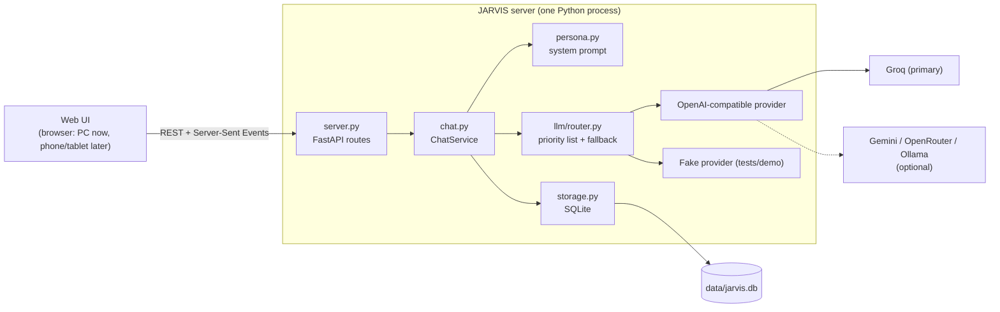

# Architecture

JARVIS is a single Python process: a FastAPI server that serves the web
interface, stores conversations in SQLite and talks to language models through a
swappable provider layer. This is deliberately the simplest shape that can grow
into the full system. Each future phase adds a module behind an existing seam,
not a rewrite.

## Current system (v0.1, Phase 1)



### A chat turn, step by step

1. The browser `POST`s `/api/chat` with the message and the conversation ID (or none for a new conversation).
2. `ChatService.start_turn` validates the message, creates the conversation if needed and saves the user message.
3. `build_context` assembles the system prompt (personality, capabilities, current date and time) plus the most recent history that fits `JARVIS_MAX_HISTORY_MESSAGES` and `JARVIS_MAX_CONTEXT_CHARS`.
4. `ModelRouter` tries each configured model in order. Any failure *before the first token* (rate limit, outage, bad key, empty reply) moves on to the next model. A failure after text has started is reported instead, so replies are never spliced from two models.
5. Tokens stream back to the browser as Server-Sent Events: `conversation`, `model`, `token`…, then `done` or `error`.
6. The finished reply is saved along with the model that wrote it. If the user presses Stop, the partial reply is saved and marked `[Stopped]`.

### Data model

| Table | Columns |
|---|---|
| `conversations` | `id` (hex UUID), `title`, `created_at`, `updated_at` (ISO-8601 UTC) |
| `messages` | `id`, `conversation_id` (cascade delete), `role` (`user`/`assistant`), `content`, `model`, `created_at` |

Schema changes are numbered migrations in `storage.py`, tracked with `PRAGMA user_version`, so existing databases upgrade in place.

### API

| Method | Path | Purpose |
|---|---|---|
| GET | `/api/health` | Status, configured models, models skipped (and why) |
| GET | `/api/conversations` | List, newest activity first |
| GET | `/api/conversations/{id}` | One conversation and its messages |
| PATCH | `/api/conversations/{id}` | Rename (`{"title": ...}`) |
| DELETE | `/api/conversations/{id}` | Delete with its messages |
| POST | `/api/chat` | Send a message; the reply streams as SSE |

Interactive API docs are at `http://127.0.0.1:8000/docs` while JARVIS is running.

## How the target layers map onto the code

| Layer (from the project spec) | Today | Where it will grow |
|---|---|---|
| AI model layer | `llm/`: any OpenAI-compatible API, ordered fallback | Per-task model selection; tool-calling models |
| Orchestration | `chat.py` | Agent loop with tools, task state, approval checkpoints (Phases 4 and 6) |
| Memory | Conversation history (SQLite) | `memory/` module: facts, preferences, project notes, retrieval into context (Phase 3) |
| Tools | None | `tools/` registry with permission levels, audit log (Phase 4) |
| Voice | None | Browser microphone, then local speech-to-text and text-to-speech (Phase 2) |
| Backend | FastAPI + SQLite | Authentication and sync for remote devices (Phase 7) |
| Frontend | `web/`: vanilla JS, no build step | Voice controls, memory and settings pages; installable phone/tablet app (PWA) |
| Security | Localhost-only binding; secrets in `.env` | Login, permission tiers, confirmations for risky actions |
| Monitoring | Console logs; model shown per message | Usage and rate-limit tracking, error log page |

## Design principles

1. **One process, one database file** until there's a concrete reason for more.
2. **Providers are configuration, not code.** Switching or adding a model is an edit to `.env`.
3. **Fail loudly and helpfully.** Every error tells the user what to do next.
4. **Honest capabilities.** The system prompt lists exactly what JARVIS can and can't do, and changes only when the code does.
5. **Security by default.** Localhost-only, no secrets in git, approval required before anything risky (enforced from Phase 4).

## Adding a model provider

If the service is OpenAI-compatible (most are), add a preset in `llm/router.py`:

```python
PRESETS["newprovider"] = ProviderPreset("https://api.example.com/v1", "NEWPROVIDER_API_KEY")
```

Then add the key name to `key_names` in `config.py`, document it in `.env.example`, and use `newprovider:<model>` in `JARVIS_MODELS`.
