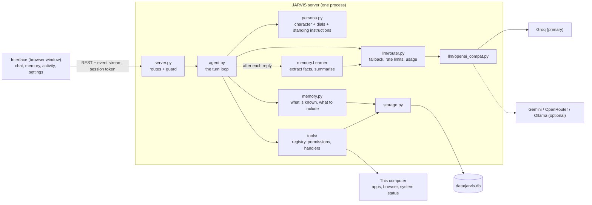

# Architecture (v2.2)

JARVIS is one Python process. A FastAPI server serves the interface, keeps
everything in a single SQLite file and talks to language models through a
swappable provider layer. Between the interface and the model sits the agent,
which gives the model a personality, a memory and tools.

## One turn, step by step

1. The interface posts the message to `/api/chat`. The reply comes back as a
   stream of events.
2. `Agent.build_context` assembles what the model sees:
   - the **personality** (fixed character, the user's dials, standing instructions),
   - **what JARVIS knows about the user** (see Memory below),
   - a **summary** of earlier parts of this conversation that no longer fit,
   - titles of **recent conversations**, for continuity,
   - recent **history**, with earlier tool use replayed as real tool calls.
3. `ModelRouter` asks the first available model. If it is rate-limited, down or
   returns nothing, the next is tried. A request too large for the free tier is
   retried once with less history.
4. The model either answers or asks for tools. For each tool request the agent:
   validates the arguments against the tool's schema; applies the user's
   permission (allowed / ask first / off); asks for approval when required and
   waits; runs the handler with a timeout; records the outcome in the action
   log; and hands the real result back to the model. Then back to step 3, up to
   the step limit.
5. The reply is saved together with its steps, so reopening a conversation
   shows exactly what was done.
6. In the background, the **Learner** asks a side model whether the user said
   anything durable, and stores it. If the conversation has outgrown its
   history budget, it also updates the rolling summary.

## Memory

| Piece | Where | What it does |
|---|---|---|
| Store | `storage.py` (`memories` table + full-text index) | Five kinds: standing instructions, preferences, about you, projects, notes. Each records where it came from and when. |
| Rules | `memory.Memory` | Cleans content, refuses secrets, merges near-duplicates, chooses what accompanies each reply. |
| Selection | `Memory.context` | While everything fits in about 1,800 characters, **all of it** is sent with every message, so nothing can be missed by a poor search. Beyond that: pinned first, then full-text matches for the message, then recent basics. |
| Told | `tools/memory_tools.py` | The model calls `remember` / `forget` / `recall` / `search_conversations` during a conversation. |
| Learned | `memory.Learner.reflect` | After a reply, if the message looked personal, a side model extracts up to three facts or corrections as JSON. Shown in the conversation with Undo. |
| Managed | Memory screen, `/api/memories` | Search, add, edit, pin, delete, export, switch off. |
| Conversation memory | `conversations.summary`, messages full-text index | Rolling summary of long conversations; search across all past ones. |

Standing instructions (kind `style`) are placed in the prompt ahead of the
default behaviour, which is how "shorter answers" or "stop calling me sir"
persist.

## Personality

`persona.py` is the only place the voice is defined. The prompt is built from:

1. A fixed character with rules for voice and for different situations, plus a
   handful of original example exchanges (models imitate examples far more
   reliably than adjectives).
2. Three dials set in Settings: manner, humour, answer length. Each maps to one
   line of the prompt.
3. Standing instructions from memory and the user's own free-text instructions.
4. A capability list generated from the tools that are actually switched on,
   so JARVIS cannot claim an ability it lacks.

## Tools and permissions

| Risk | Meaning | Default |
|---|---|---|
| read | Looks something up, changes nothing | Runs |
| act | Small, visible, reversible | Runs, unless the user chose "ask first" or "ask before every action" |
| sensitive | Hard to undo | Always asks; can be switched off but never set to run unasked |

If a turn has read outside content (web pages, files: coming in 2.2), every
non-read action in that turn needs approval, whatever its setting. This is the
defence against instructions hidden in documents.

Current tools: `remember`, `recall`, `forget`, `search_conversations`,
`open_app`, `close_app`, `open_url`, `get_system_info`, `list_files`,
`read_file`, `write_file`, `open_file`, `move_file`, `delete_file`, and the
task tools `add_todo`, `list_todos`, `change_todo`, `edit_todo`, `delete_todo`,
`create_plan`, `list_plans`, `change_plan_step`, `resume_plan`, `begin_plan_step`,
and `complete_plan_step`. File reads are marked as
untrusted output; sensitive app/file mutations always require approval. Adding
one means writing a handler and a `Tool(...)` entry; permissions, approvals,
logging and the interface come for free.

## Model layer

- One client (`openai_compat.py`) for every OpenAI-compatible provider. It
  assembles streamed tool calls from fragments, reads usage and rate-limit
  headers, and drops optional fields a provider rejects.
- The router rests a rate-limited model for the time the provider asks, uses
  the next model meanwhile, and waits briefly only if all are resting.
- Usage per model per day is stored, and shown in Settings with the provider's
  own "remaining" figures.
- When a Groq key is added, the model order is chosen from what that account
  can actually see.

## Security

- Listens on `127.0.0.1` only.
- Every `/api` call must carry a secret token that only JARVIS's own page is
  given, must be addressed to this machine, and must not come from another
  site's page. A web page in another tab cannot drive JARVIS.
- API keys live only in `.env`; the interface is shown only the last four characters.
- Model output is sanitised before display (DOMPurify); maths is rendered from
  plain TeX after sanitising.
- Memory refuses anything that looks like a password, key or card number.

## Data model

| Table | Purpose |
|---|---|
| `conversations` | title, timestamps, rolling `summary` |
| `messages` | text, model, and `parts` (the ordered text and tool steps of a reply) |
| `memories` | kind, content, pinned, source, usage |
| `settings` | preferences changed in the app |
| `tool_runs` | the action log |
| `todos` | durable pending and completed to-dos, with optional UTC due dates |
| `plans` / `plan_steps` | durable multi-step plans, ordered step state and execution checkpoints |
| `usage` | requests and tokens per model per day |

Schema changes are numbered migrations (`PRAGMA user_version`); a v0.1 database
upgrades in place.

## Where the next milestones plug in

| Milestone | Adds | Touches |
|---|---|---|
| 2.2 Voice | microphone capture, speech-to-text endpoint, spoken replies | new `voice.py`, one route, interface |
| 2.3 Tasks | to-dos and more file actions | task state, approval-aware tools |
| 3.0 | longer multi-step work that survives restarts | plan state, execution checkpoints and resumable agent work |

## Voice

The browser records microphone input with `MediaRecorder` and posts the audio
blob to the protected `/api/transcribe` route. The server sends it to Groq's
hosted Whisper endpoint using the existing Groq key; no audio is stored in
SQLite. The returned transcript is inserted into the ordinary chat composer, so
memory, personality, tools, permissions and approvals remain exactly the same.
After a voice-originated reply, the browser uses its built-in speech synthesis
to speak the final text. Tapping the microphone stops an active recording or
cancels active speech. While active, the composer reports listening,
transcribing or speaking; a Web Audio analyser stops recordings after sustained
silence, and a two-minute timer is the final bound. Telegram voice notes are
still a later addition, not a separate agent path.
